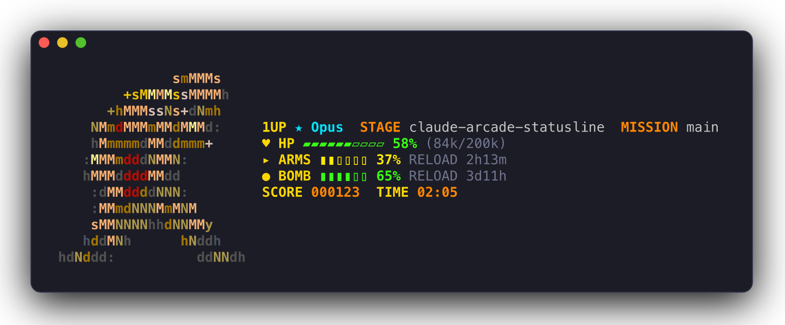

[English](README.md) | **Español**

# claude-arcade-statusline

**Un HUD arcade de 8 bits para la línea de estado de [Claude Code](https://docs.claude.com/en/docs/claude-code).**
Tu ventana de contexto es una barra de vida, tus límites de uso son la munición y el costo de la
sesión es tu puntuación.

[](https://github.com/smarriagac/claude-arcade-statusline/actions/workflows/ci.yml)
[](LICENSE)
[](https://www.rust-lang.org)


```sh
cargo install --git https://github.com/smarriagac/claude-arcade-statusline
arcade-statusline install
# luego reinicia Claude Code
```

## Muestra: modo ASCII



Cualquier imagen puede convertirse en tu personaje. Este se convirtió con
`arcade-statusline sprite <your-image> --mode ascii --rows 12`, que dibuja una letra de color por
celda, como un logo de fastfetch. Consulta [Crea tu propio personaje](#crea-tu-propio-personaje).

> El personaje de esta captura es un fan art de Marco Rossi, de *Metal Slug* (© SNK), generado
> localmente a partir de una imagen propia del autor con el conversor integrado. No se distribuye
> con este proyecto; usa tu propia imagen.

## Características

- **HUD arcade.** Contexto, límites de 5 horas y semanal, costo y tiempo de sesión, en verde,
  amarillo o rojo según se van agotando.
- **Personaje en pixel art.** Un soldado original de 8 bits aparece junto al HUD. Puedes cambiarlo
  por el tuyo.
- **Conversor de imágenes.** Convierte un PNG, JPG, GIF o una cuadrícula de píxeles en texto en un
  sprite, en estilo pixel o ASCII.
- **Instalador seguro.** Fusiona una sola clave en `~/.claude/settings.json`, con copia de
  seguridad y modo de prueba (dry run).
- **Pequeño y rápido.** Un solo binario de Rust. Sin llamadas de red, unos pocos milisegundos por
  renderizado, y nunca imprime un error en tu línea de estado.

## Instalación

### 1. Revisa los requisitos

| Necesitas | Para qué |
|-----------|----------|
| [Rust](https://rustup.rs) 1.88 o posterior, con `cargo` | Compila el binario |
| [Claude Code](https://docs.claude.com/en/docs/claude-code) | Ejecuta la línea de estado |
| Una terminal con truecolor: iTerm2, Ghostty, WezTerm, Kitty, Windows Terminal, ... | Dibuja los colores de 24 bits |
| `git` en el `PATH` (opcional) | Muestra la rama actual como `MISSION` |

### 2. Instala el binario

```sh
cargo install --git https://github.com/smarriagac/claude-arcade-statusline
```

O desde un clon:

```sh
git clone https://github.com/smarriagac/claude-arcade-statusline
cd claude-arcade-statusline
cargo install --path .
```

Ambas opciones dejan `arcade-statusline` en `~/.cargo/bin`. Compruébalo:

```sh
arcade-statusline --version
```

### 3. Conéctalo a Claude Code

Previsualiza el cambio y luego aplícalo:

```sh
arcade-statusline install --dry-run
arcade-statusline install
```


`install` cambia una sola clave de `~/.claude/settings.json`, `statusLine`, y la apunta a la ruta
absoluta del binario:

```json
"statusLine": {
  "type": "command",
  "command": "/Users/you/.cargo/bin/arcade-statusline",
  "refreshInterval": 1
}
```

| Detalle | Comportamiento |
|---------|----------------|
| Otros ajustes | Todas las demás claves, y su orden, se mantienen igual |
| Copia de seguridad | Antes de escribir, el archivo anterior se copia a su lado como `settings.json.arcade-backup-<UTC timestamp>` |
| `--dry-run` | Muestra el diff con `-`/`+` y no escribe nada |
| Aún no existe `settings.json` | Se crea; no hay nada que respaldar |
| JSON no válido | No se escribe nada; en su lugar recibes un error |
| `settings.json` es un enlace simbólico | Se actualiza el destino del enlace y se conservan sus permisos |
| Ya está instalado | Muestra `already installed; nothing changed` |

### 4. Reinicia Claude Code

Cierra Claude Code y vuelve a abrirlo (o inicia una sesión nueva). El HUD aparece en la parte
inferior, debajo del prompt.

### 5. Verifica

- En Claude Code deberías ver el soldado y el HUD.
- `arcade-statusline install --dry-run` debería mostrar `already installed; nothing changed`.
- Para probar el HUD sin Claude Code, pásale un estado de ejemplo por la entrada estándar:

  ```sh
  echo '{"model":{"display_name":"Opus"},"cost":{"total_cost_usd":1.23,"total_duration_ms":125000},
  "context_window":{"used_percentage":42,"context_window_size":200000,"total_input_tokens":84000}}' \
    | arcade-statusline
  ```

### Desinstalación

```sh
arcade-statusline uninstall
cargo uninstall claude-arcade-statusline
```

`uninstall` restaura el `statusLine` que tenías antes de `install` (lo lee de la copia de seguridad
más reciente), o elimina la clave si no tenías ninguno. Antes guarda el archivo actual como
`settings.json.arcade-uninstall-<UTC timestamp>`. Si `statusLine` no ejecuta arcade-statusline, no
modifica el archivo.

## Cómo leer el HUD


Las etiquetas del HUD se muestran en inglés, como en las máquinas arcade clásicas: `1UP` (jugador
1), `STAGE` (escenario), `MISSION` (misión), `HP` (puntos de vida), `ARMS` (armas), `BOMB`
(bombas), `COIN` (monedas), `SCORE` (puntuación), `TIME` (tiempo) y `RELOAD` (recarga).

| HUD | Significado | Campo de origen |
|-----|-------------|-----------------|
| `1UP ★ Opus` | El modelo actual | `model.display_name` |
| `STAGE` | Nombre del directorio de trabajo | `workspace.current_dir` |
| `MISSION` | Rama actual de git; se oculta fuera de un repositorio | `git branch --show-current` |
| `♥ HP` | Ventana de contexto **restante**: barra de 10 celdas, porcentaje y tokens `(used k/window k)` (usados / tamaño de la ventana, en miles) | `context_window` |
| `▸ ARMS` | Límite de uso de 5 horas **restante**: barra de 6 celdas y tiempo hasta el reinicio (`RELOAD`) | `rate_limits.five_hour` |
| `● BOMB` | Límite de uso semanal **restante**, igual que ARMS | `rate_limits.seven_day` |
| `¢ COIN` | Límite de gasto restante; solo cuando Claude Code lo envía | `rate_limits.spend_limit` |
| `SCORE` | Costo de la sesión en centavos, 6 dígitos: $1.23 es `000123` | `cost.total_cost_usd` |
| `TIME` | Tiempo de sesión, `MM:SS`, o `H:MM:SS` a partir de la primera hora | `cost.total_duration_ms` |

| Color | Significado |
|-------|-------------|
| Verde | Menos del 50 % usado |
| Amarillo | Del 50 al 79 % usado |
| Rojo | 80 % usado o más |
| Gris | Detalle secundario: recuento de tokens y tiempos de `RELOAD` |

`RELOAD` muestra `3d11h`, `2h13m` o `45m`, y `now` una vez que pasa la hora de reinicio. Un campo
ausente, `null` o mal formado oculta solo su propio segmento.

## Crea tu propio personaje

El comando `sprite` convierte una imagen en un archivo de sprite. Este es el soldado
predeterminado, guardado como PNG ([`docs/examples/character.png`](docs/examples/character.png)) y
convertido de las dos formas:


**Modo pixel** (el predeterminado) usa medios bloques: dos píxeles por celda de texto. Ideal para
pixel art.


**Modo ASCII** usa una letra de color por celda, como un logo de fastfetch. Ideal para logos.


Primero previsualiza y luego guarda:

```sh
arcade-statusline sprite hero.png --rows 9 --preview   # lo muestra, no escribe nada
arcade-statusline sprite hero.png --rows 9             # lo guarda como tu sprite
```

| Opción | Predeterminado | Notas |
|--------|----------------|-------|
| `--mode` | `pixel` | `pixel` o `ascii` |
| `--rows` | 10 (pixel), 12 (ascii) | Altura en filas de texto. Entre 6 y 10 se ve mejor junto al HUD |
| `--colors` | 14 | Tamaño de la paleta, solo en modo ASCII |
| `--out` | `~/.config/arcade-statusline/sprite.ansi` | Dónde se escribe el sprite |
| `--preview` | desactivado | Muestra el sprite. Sin `--out`, no se escribe nada |

Consejos para las imágenes:

- Funcionan PNG, JPG y GIF. Los píxeles blancos y transparentes no se dibujan y dejan ver el fondo.
- Primero la imagen se recorta a su contenido, así que los márgenes no importan.
- Para pixel art, dibuja en pequeño (unos 16 x 18 píxeles) y ajusta `--rows` a la mitad de la
  altura del dibujo (`--rows 9` para 18 píxeles). Así cada píxel corresponde exactamente a un
  medio bloque.

### Dibújalo como texto

La forma más sencilla es una cuadrícula de píxeles en texto. Copia
[`assets/default-sprite.txt`](assets/default-sprite.txt), edita la copia y conviértela:

```text
# my-hero.txt: las líneas de paleta son "<key> <r> <g> <b>", luego "---" y luego los píxeles.
K 20 20 30
R 230 60 50
S 240 190 140
---
..KKKK..
.KSSSSK.
.KSKSKK.
..KRRK..
.KRRRRK.
..K..K..
```

```sh
arcade-statusline sprite my-hero.txt
```

- Las líneas que empiezan con `#` son comentarios.
- Cada carácter de la cuadrícula es un píxel. `.` o un espacio es transparente; usa `.` para una
  fila vacía.
- Dos filas de la cuadrícula forman una fila de texto, así que una cuadrícula de 18 píxeles ocupa
  9 filas.
- Una cuadrícula de texto se dibuja exactamente como está escrita; `--mode` y `--rows` no se
  aplican.

### De dónde sale el sprite

El HUD usa el primer sprite que puede leer, en este orden:

1. `--sprite <file>`
2. la variable de entorno `ARCADE_STATUSLINE_SPRITE`
3. `~/.config/arcade-statusline/sprite.ansi`
4. el soldado integrado

Un archivo de sprite es texto plano: una fila por línea, con códigos de escape ANSI truecolor, y
una primera línea opcional `#width N` que declara el ancho en celdas. Las filas más cortas se
rellenan, así que el HUD siempre queda alineado.

## Configuración

| Ajuste | Efecto |
|--------|--------|
| `--sprite <file>` | Dibuja este archivo de sprite |
| `--no-sprite` | Sin sprite: el HUD compacto de dos líneas que se ve abajo |
| `ARCADE_STATUSLINE_SPRITE` | Ruta de un archivo de sprite, usada cuando no se indica `--sprite` |


Para usar una opción, añádela al comando en `~/.claude/settings.json`:

```json
"statusLine": {
  "type": "command",
  "command": "/Users/you/.cargo/bin/arcade-statusline --no-sprite",
  "refreshInterval": 1
}
```

Si vuelves a ejecutar `install`, el comando se restablece a la ruta del binario sin opciones.

| Comando | Qué hace |
|---------|----------|
| `arcade-statusline` | Lee el JSON de estado por stdin e imprime el HUD (igual que `render`) |
| `arcade-statusline render [--sprite FILE] [--no-sprite]` | Lo mismo, con un sprite explícito o sin ninguno |
| `arcade-statusline sprite IMAGE [OPTIONS]` | Convierte una imagen o una cuadrícula de texto en un archivo de sprite |
| `arcade-statusline install [--dry-run]` | Apunta el `statusLine` de Claude Code a este binario, tras hacer una copia de seguridad |
| `arcade-statusline uninstall` | Restaura el `statusLine` anterior o elimina la clave |

## Solución de problemas

| Síntoma | Causa y solución |
|---------|------------------|
| Las filas del sprite aparecen desplazadas a la izquierda | Claude Code elimina los espacios iniciales de cada fila de la línea de estado. arcade-statusline dibuja las celdas transparentes como U+2800 (braille en blanco), que se ve vacío pero no es un espacio en blanco. Los espacios de tus propios archivos de sprite se convierten automáticamente. Si las celdas transparentes muestran recuadros, ni tu fuente ni sus fuentes de respaldo tienen glifos braille; instala una que los tenga, como JetBrainsMono Nerd Font. |
| Los colores se ven mal o apagados | Tu terminal no admite truecolor (24 bits), algo que no tienen algunas terminales, como las versiones antiguas de Terminal.app de Apple. Usa una terminal de la lista de requisitos; en la mayoría, `echo $COLORTERM` imprime `truecolor` o `24bit`. |
| Recuadros en lugar de `▀ ▄ ▰ ▱ ▮ ▯ ★ ♥` | A tu fuente le faltan esos glifos y la terminal no recurre a otra fuente. Menlo, por ejemplo, los tiene todos. |
| Falta `MISSION` (la rama de git) | Solo aparece dentro de un repositorio git con una rama activa (no con un `HEAD` desacoplado), y necesita `git` en el `PATH` que usa Claude Code. |
| No aparece el HUD | Ejecuta `arcade-statusline install --dry-run` para ver qué contiene `statusLine`. Si moviste el binario o lo compilaste en otra ubicación, vuelve a ejecutar `install`. Luego prueba el ejemplo del paso 5. |

## Desarrollo

```sh
cargo fmt --check
cargo clippy --all-targets -- -D warnings
cargo test
cargo build --release
```

La CI ejecuta los mismos pasos de formato, lint y pruebas en Ubuntu y macOS en cada push a `main`
y en cada pull request ([`.github/workflows/ci.yml`](.github/workflows/ci.yml)).

| Módulo | Función |
|--------|---------|
| `input` | Structs de serde tolerantes para el JSON de estado |
| `hud` | Renderizado puro; el momento actual ("now") y la rama de git se inyectan |
| `sprite` | El formato de archivo de sprite, el formato de cuadrícula de texto y el personaje predeterminado |
| `convert` | Algoritmos de imagen: recorte, cuantización, modo ASCII y modo pixel con medios bloques |
| `install` | Fusión de `settings.json`, copias de seguridad y restauración |

El modo ASCII cuantiza la imagen igual que `Quantize.MAXCOVERAGE` de Pillow. El primer color de la
paleta es el color de la imagen más alejado de la media. Cada color siguiente es el más alejado de
todos los elegidos hasta ese momento. Después, cada píxel se asigna a su color más cercano de la
paleta. Los empates se resuelven a favor del valor RGB más bajo, así que el resultado es
determinista.

### Capturas de pantalla

Las imágenes de `docs/` se generan con [`scripts/screenshots.sh`](scripts/screenshots.sh). El
script compila el binario de release, le pasa JSON de estado de ejemplo, captura cada escena con
[freeze](https://github.com/charmbracelet/freeze) y la rasteriza con
[resvg](https://github.com/linebender/resvg). La escena de instalación se ejecuta con `HOME`
apuntando a un directorio temporal, así que nunca toca tu configuración real.

```sh
brew install charmbracelet/tap/freeze resvg   # además de python3 con Pillow
scripts/screenshots.sh
```

Usa Menlo de forma predeterminada (macOS). En otros sistemas, define `FONT_FAMILY` y `FONT_FILE`
con otra fuente monoespaciada. La cabecera del script explica por qué posprocesa el SVG de freeze
en lugar de usar su salida PNG.

La imagen de muestra (`hud-showcase.png`) es opcional, porque su sprite no está en el repositorio.
Crea un sprite con `arcade-statusline sprite` y luego captura solo esa escena:

```sh
SHOWCASE_SPRITE=<path> SCENES=hud-showcase scripts/screenshots.sh
```

| Variable | Efecto |
|----------|--------|
| `SHOWCASE_SPRITE` | Archivo de sprite para la escena `hud-showcase`, por ejemplo `~/.config/arcade-statusline/sprite.ansi`. Sin ella, `SCENES=hud-showcase` se detiene con `unknown scene` |
| `SCENES` | Nombres de las escenas que se capturan, separados por espacios. Predeterminado: `hud hud-critical hud-compact sprite-ascii sprite-pixel install` |

## Licencia

[MIT](LICENSE) © Sebastian Marriaga

Inspirado en los HUD de las máquinas arcade clásicas de los 90. Sin afiliación con ninguna editora
de videojuegos. *Metal Slug* es una marca comercial de SNK; se menciona aquí solo para dar crédito
al fan art de la captura de muestra.
