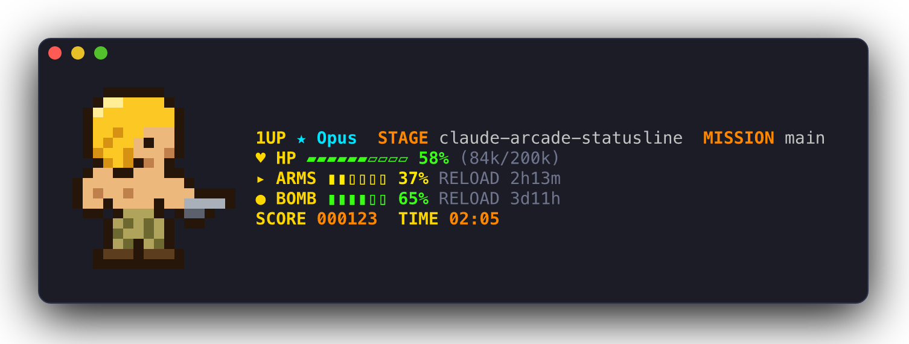
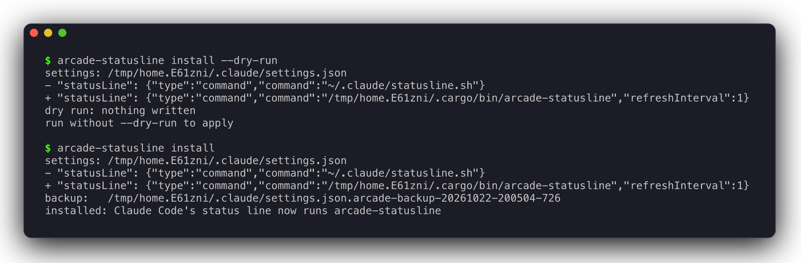
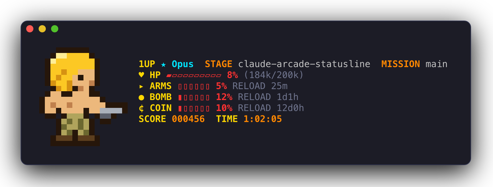
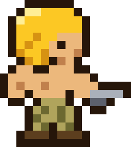
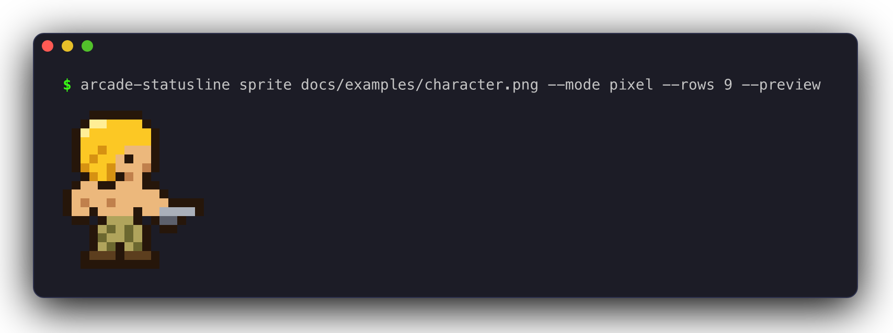
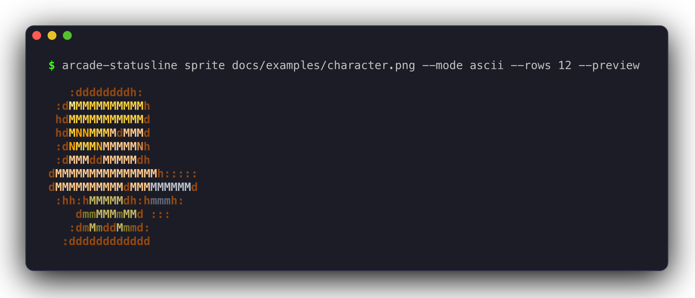
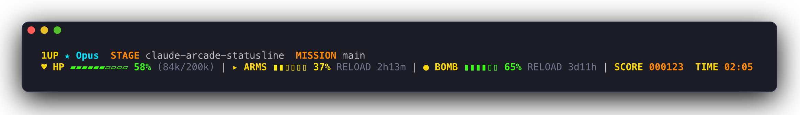

# claude-arcade-statusline

**An 8-bit arcade HUD for the [Claude Code](https://docs.claude.com/en/docs/claude-code) status line.**
Your context window is a health bar, your rate limits are ammo, and session cost is your score.

[](https://github.com/<owner>/claude-arcade-statusline/actions/workflows/ci.yml)
[](LICENSE)
[](https://www.rust-lang.org)



```sh
cargo install --git https://github.com/<owner>/claude-arcade-statusline
arcade-statusline install
# then restart Claude Code
```

## Features

- **Arcade HUD.** Context, 5-hour and weekly limits, cost and session time, colored green, yellow
  or red as they run low.
- **Pixel-art character.** An original 8-bit soldier stands next to the HUD. Swap in your own.
- **Image converter.** Turns a PNG, JPG, GIF or text pixel grid into a sprite, in pixel or ASCII
  style.
- **Safe installer.** Merges one key into `~/.claude/settings.json`, with a backup and a dry run.
- **Small and fast.** One Rust binary. No network calls, a few milliseconds per render, and it never
  prints an error into your status line.

## Installation

### 1. Check the requirements

| You need | Why |
|----------|-----|
| [Rust](https://rustup.rs) 1.88 or newer, with `cargo` | Builds the binary |
| [Claude Code](https://docs.claude.com/en/docs/claude-code) | Runs the status line |
| A truecolor terminal: iTerm2, Ghostty, WezTerm, Kitty, Windows Terminal, ... | Draws the 24-bit colors |
| `git` on `PATH` (optional) | Shows the current branch as `MISSION` |

### 2. Install the binary

```sh
cargo install --git https://github.com/<owner>/claude-arcade-statusline
```

Or from a clone:

```sh
git clone https://github.com/<owner>/claude-arcade-statusline
cd claude-arcade-statusline
cargo install --path .
```

Both put `arcade-statusline` in `~/.cargo/bin`. Check it:

```sh
arcade-statusline --version
```

### 3. Connect it to Claude Code

Preview the change, then apply it:

```sh
arcade-statusline install --dry-run
arcade-statusline install
```



`install` changes one key in `~/.claude/settings.json`, `statusLine`, and points it at the absolute
path of the binary:

```json
"statusLine": {
  "type": "command",
  "command": "/Users/you/.cargo/bin/arcade-statusline",
  "refreshInterval": 1
}
```

| Detail | Behavior |
|--------|----------|
| Other settings | Every other key, and the key order, stays as it was |
| Backup | Before writing, the old file is copied next to it as `settings.json.arcade-backup-<UTC timestamp>` |
| `--dry-run` | Prints the `-`/`+` diff and writes nothing |
| No `settings.json` yet | It is created; there is nothing to back up |
| Invalid JSON | Nothing is written; you get an error instead |
| Symlinked `settings.json` | The link target is updated, and its permissions are kept |
| Already installed | Prints `already installed; nothing changed` |

### 4. Restart Claude Code

Quit Claude Code and start it again (or open a new session). The HUD appears at the bottom, under
the prompt.

### 5. Verify

- In Claude Code, you should see the soldier and the HUD.
- `arcade-statusline install --dry-run` should print `already installed; nothing changed`.
- To test the HUD without Claude Code, pipe in a sample status:

  ```sh
  echo '{"model":{"display_name":"Opus"},"cost":{"total_cost_usd":1.23,"total_duration_ms":125000},
  "context_window":{"used_percentage":42,"context_window_size":200000,"total_input_tokens":84000}}' \
    | arcade-statusline
  ```

### Uninstall

```sh
arcade-statusline uninstall
cargo uninstall claude-arcade-statusline
```

`uninstall` puts back the `statusLine` you had before `install` (read from the newest backup), or
removes the key if you had none. It saves the current file as
`settings.json.arcade-uninstall-<UTC timestamp>` first. If `statusLine` does not run
arcade-statusline, it leaves the file alone.

## Reading the HUD



| HUD | Meaning | Source field |
|-----|---------|--------------|
| `1UP ★ Opus` | The current model | `model.display_name` |
| `STAGE` | Name of the working directory | `workspace.current_dir` |
| `MISSION` | Current git branch; hidden outside a repository | `git branch --show-current` |
| `♥ HP` | Context window **remaining**: 10-cell bar, percent, `(used k/window k)` tokens | `context_window` |
| `▸ ARMS` | 5-hour rate limit **remaining**: 6-cell bar, `RELOAD` countdown | `rate_limits.five_hour` |
| `● BOMB` | Weekly rate limit **remaining**, same as ARMS | `rate_limits.seven_day` |
| `¢ COIN` | Spend limit remaining; only when Claude Code sends it | `rate_limits.spend_limit` |
| `SCORE` | Session cost in cents, 6 digits: $1.23 is `000123` | `cost.total_cost_usd` |
| `TIME` | Session time, `MM:SS`, or `H:MM:SS` from one hour on | `cost.total_duration_ms` |

| Color | Meaning |
|-------|---------|
| Green | Less than 50% used |
| Yellow | 50 to 79% used |
| Red | 80% used or more |
| Gray | Secondary detail: token counts and `RELOAD` times |

`RELOAD` reads `3d11h`, `2h13m` or `45m`, and `now` once the reset time has passed. A field that is
missing, `null` or malformed hides only its own segment.

## Create your own character

The `sprite` command turns an image into a sprite file. This is the default soldier, saved as a
PNG ([`docs/examples/character.png`](docs/examples/character.png)) and converted both ways:



**Pixel mode** (the default) uses half blocks: two pixels per text cell. Best for pixel art.



**ASCII mode** uses one colored letter per cell, like a fastfetch logo. Best for logos.



Preview first, then save:

```sh
arcade-statusline sprite hero.png --rows 9 --preview   # print it, write nothing
arcade-statusline sprite hero.png --rows 9             # save it as your sprite
```

| Option | Default | Notes |
|--------|---------|-------|
| `--mode` | `pixel` | `pixel` or `ascii` |
| `--rows` | 10 (pixel), 12 (ascii) | Height in text rows. 6 to 10 looks best next to the HUD |
| `--colors` | 14 | Palette size, ASCII mode only |
| `--out` | `~/.config/arcade-statusline/sprite.ansi` | Where the sprite is written |
| `--preview` | off | Prints the sprite. Without `--out`, nothing is written |

Tips for images:

- PNG, JPG and GIF work. White and transparent pixels become see-through.
- The image is cropped to its content first, so margins do not matter.
- For pixel art, draw small (about 16 x 18 pixels) and set `--rows` to half the drawing's height
  (`--rows 9` for 18 pixels). Then every pixel maps to exactly one half block.

### Draw it as text

The easiest route is a text pixel grid. Copy [`assets/default-sprite.txt`](assets/default-sprite.txt),
edit it, and convert it:

```text
# my-hero.txt: palette lines are "<key> <r> <g> <b>", then "---", then the pixels.
K 20 20 30
R 230 60 50
S 240 190 140
---
..KKKK..
.KSSSSK.
.KSKSKK.
..KRRK..
.KRRRRK.
..K..K..
```

```sh
arcade-statusline sprite my-hero.txt
```

- Lines starting with `#` are comments.
- Every grid character is one pixel. `.` or a space is transparent; use `.` for an empty row.
- Two grid rows make one text row, so an 18-pixel grid is 9 rows high.
- A text grid is drawn exactly as written; `--mode` and `--rows` do not apply.

### Where the sprite comes from

The HUD uses the first sprite it can read, in this order:

1. `--sprite <file>`
2. the `ARCADE_STATUSLINE_SPRITE` environment variable
3. `~/.config/arcade-statusline/sprite.ansi`
4. the built-in soldier

A sprite file is plain text: one row per line, with ANSI truecolor escape codes, and an optional
first line `#width N` that declares the width in cells. Shorter rows are padded, so the HUD always
lines up.

## Configuration

| Setting | Effect |
|---------|--------|
| `--sprite <file>` | Draw this sprite file |
| `--no-sprite` | No sprite: the compact two-line HUD below |
| `ARCADE_STATUSLINE_SPRITE` | Path of a sprite file, used when `--sprite` is not given |



To use a flag, add it to the command in `~/.claude/settings.json`:

```json
"statusLine": {
  "type": "command",
  "command": "/Users/you/.cargo/bin/arcade-statusline --no-sprite",
  "refreshInterval": 1
}
```

Running `install` again resets the command to the plain binary path.

| Command | What it does |
|---------|--------------|
| `arcade-statusline` | Reads the status JSON on stdin and prints the HUD (same as `render`) |
| `arcade-statusline render [--sprite FILE] [--no-sprite]` | Same, with an explicit sprite or none |
| `arcade-statusline sprite IMAGE [OPTIONS]` | Converts an image or text grid into a sprite file |
| `arcade-statusline install [--dry-run]` | Points Claude Code's `statusLine` at this binary, after a backup |
| `arcade-statusline uninstall` | Restores the previous `statusLine`, or removes the key |

## Troubleshooting

| Symptom | Cause and fix |
|---------|---------------|
| Sprite rows are shifted left | Claude Code trims leading spaces from every status line row. arcade-statusline draws transparent cells as U+2800 (braille blank), which looks empty but is not whitespace. Spaces in your own sprite files are converted for you. If see-through cells show boxes, neither your font nor its fallbacks has braille glyphs; install a font that does, such as JetBrainsMono Nerd Font. |
| Colors look wrong or flat | Your terminal lacks truecolor (24-bit) support, which some terminals, such as older versions of Apple's Terminal.app, do not have. Use a terminal from the requirements list; `echo $COLORTERM` prints `truecolor` or `24bit` in most of them. |
| Boxes instead of `▀ ▄ ▰ ▱ ▮ ▯ ★ ♥` | Your font lacks those glyphs and the terminal does not fall back to another font. Menlo, for example, has them all. |
| `MISSION` (the git branch) is missing | It only shows inside a git repository with a checked-out branch (not a detached `HEAD`), and needs `git` on the `PATH` that Claude Code uses. |
| No HUD at all | Run `arcade-statusline install --dry-run` to see what `statusLine` holds. If you moved or rebuilt the binary elsewhere, run `install` again. Then try the sample from step 5. |

## Development

```sh
cargo fmt --check
cargo clippy --all-targets -- -D warnings
cargo test
cargo build --release
```

CI runs the same format, lint and test steps on Ubuntu and macOS for every push to `main` and every
pull request ([`.github/workflows/ci.yml`](.github/workflows/ci.yml)).

| Module | Role |
|--------|------|
| `input` | Lenient serde structs for the status JSON |
| `hud` | Pure rendering; "now" and the git branch are injected |
| `sprite` | The sprite file format, the text grid format and the default character |
| `convert` | Image algorithms: crop, quantize, ASCII mode and half-block pixel mode |
| `install` | `settings.json` merge, backups and restore |

ASCII mode quantizes the image the same way as Pillow's `Quantize.MAXCOVERAGE`. The first palette
color is the image color furthest from the mean. Each next color is the one furthest from all colors
picked so far. Every pixel then maps to its nearest palette color. Ties go to the lowest RGB value,
so the output is deterministic.

### Screenshots

The images in `docs/` come from [`scripts/screenshots.sh`](scripts/screenshots.sh). It builds the
release binary, feeds it sample status JSON, captures each scene with
[freeze](https://github.com/charmbracelet/freeze) and rasterizes it with
[resvg](https://github.com/linebender/resvg). The install scene runs with `HOME` set to a temporary
directory, so it never touches your real settings.

```sh
brew install charmbracelet/tap/freeze resvg   # plus python3 with Pillow
scripts/screenshots.sh
```

It uses Menlo by default (macOS). Elsewhere, set `FONT_FAMILY` and `FONT_FILE` to another monospace
font. The script header explains why it post-processes freeze's SVG instead of using its PNG output.

## License

[MIT](LICENSE) © Sebastian Marriaga

Inspired by classic 90s arcade HUDs. Not affiliated with any game publisher.
